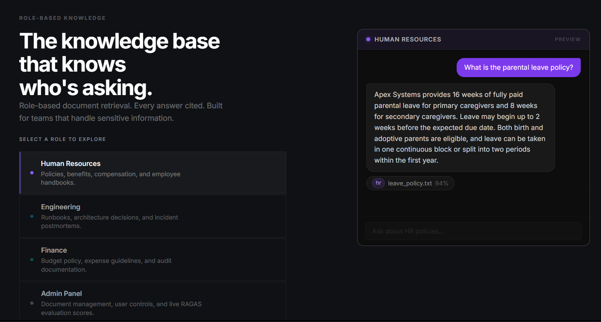
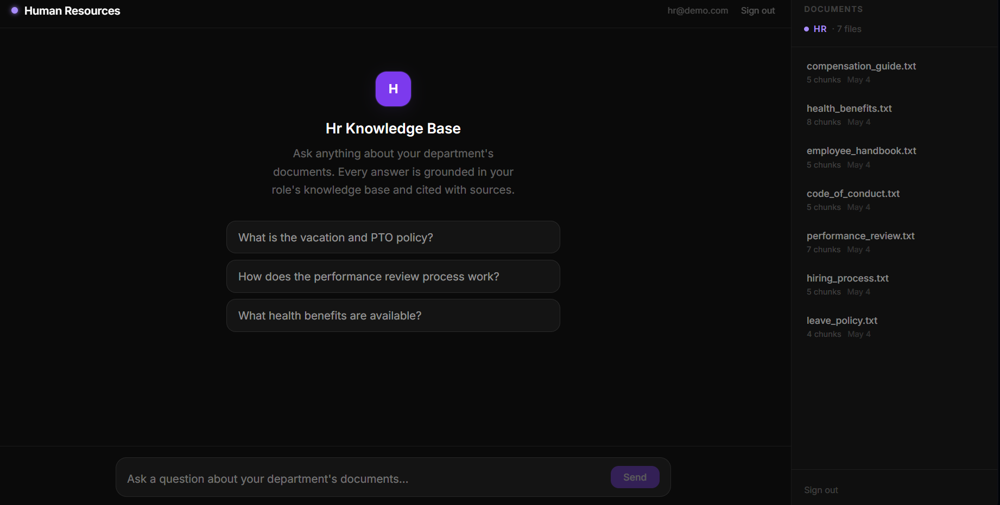
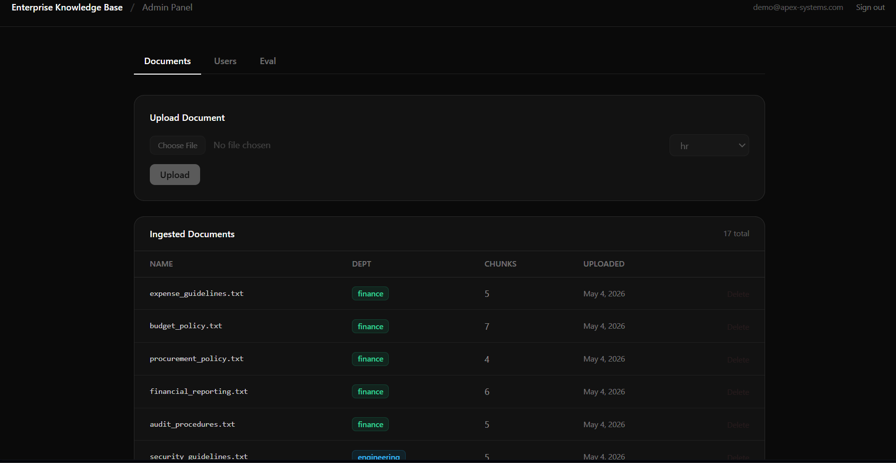
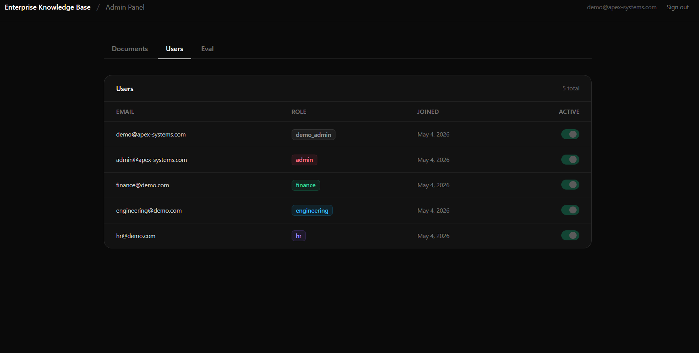
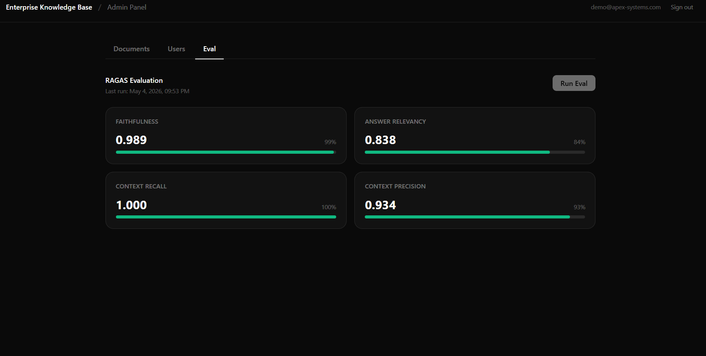

# Enterprise RAG with RBAC and Hybrid Search

> **Live Deployment:**
> - **Frontend (Vercel):** [https://nexus-rag-enterprise-ai-knowledge-s.vercel.app](https://nexus-rag-enterprise-ai-knowledge-s.vercel.app/)
> - **Backend (Render):** [https://nexusrag-enterprise-ai-knowledge-system.onrender.com](https://nexusrag-enterprise-ai-knowledge-system.onrender.com/health)
>
> **Demo Accounts:**
> | Role | Email | Password |
> |---|---|---|
> | **Admin** | `admin@example.com` | `admin-demo-2026` |
> | **HR** | `hr@demo.com` | `hr-demo-2026` |
> | **Engineering** | `engineering@demo.com` | `eng-demo-2026` |
> | **Finance** | `finance@demo.com` | `fin-demo-2026` |

A retrieval-augmented generation system modeling a role-restricted enterprise knowledge base split across three departments: HR, Engineering, and Finance. Each user role can only retrieve documents tagged for their department. RBAC is enforced at the Qdrant query layer, not in application code after retrieval, so restricted chunks never enter the LLM context. Retrieval uses a hybrid pipeline: dense embeddings fused with BM25 sparse scores via Reciprocal Rank Fusion, followed by a cross-encoder reranker. Answers stream back token by token via SSE.

---

## Screenshots







---

## Tech Stack

| Layer | Technology |
|---|---|
| API | FastAPI, Uvicorn, Pydantic v2 |
| Auth | JWT (HttpOnly cookies), bcrypt, python-jose |
| Database | PostgreSQL, SQLAlchemy (async), asyncpg |
| Vector store | Qdrant (self-hosted) |
| Sparse retrieval | BM25s |
| Embeddings | BAAI/bge-small-en-v1.5 |
| Reranker | cross-encoder/ms-marco-MiniLM-L-6-v2 |
| Generation | Google Gemini (gemini-2.5-flash via google-genai SDK) |
| Tracing | LangSmith |
| Evaluation | RAGAS |
| Rate limiting | slowapi |
| Frontend | React, Vite, Tailwind CSS |
| Infrastructure | Docker |

---

## How It Works

### Hybrid Search Pipeline

Queries run two retrievals in parallel. Dense retrieval uses cosine similarity over bge-small-en-v1.5 embeddings stored in Qdrant. Sparse retrieval scores the same query against a BM25s index loaded in-process from disk. The two ranked lists are merged using Reciprocal Rank Fusion, which sums inverse-rank scores without needing any learned fusion weights. The fused list is then re-scored by a cross-encoder (MiniLM-L-6-v2), which reads query and passage together rather than comparing independent embeddings. Top-K results after reranking go to Google Gemini (`gemini-2.5-flash`) for generation.

Dense embeddings alone miss exact keyword matches. BM25 alone misses semantic similarity. RRF merges them without requiring a training set or a calibrated score normalization step. The cross-encoder improves precision at the top of the list because bi-encoder scores (used for dense retrieval) are approximate by construction.

### RBAC Enforcement

Role filtering runs as a Qdrant payload filter, applied before any vectors are scored. The JWT carries the user's role claim. That claim is passed directly into the Qdrant `must` filter on `allowed_roles`. No post-retrieval filtering occurs. This means a finance user cannot receive an HR chunk even if the application code is changed, because the vector database never returns it.

Filtering after retrieval is a common pattern but it leaks information: the LLM sees restricted chunks before they get stripped. Filtering at the query level prevents that.

### Streaming

Responses stream over SSE using FastAPI's `StreamingResponse`. Tokens arrive asynchronously from the Google Gemini API (`gemini-2.5-flash`) via the `google-genai` SDK and are forwarded to the client incrementally as they arrive. The frontend renders tokens progressively using a streaming message state with automatic timeout and error recovery to prevent indefinite loading states.

---

## Key Design Decisions

**BM25s over Elasticsearch.** Elasticsearch requires a minimum 1.5GB JVM heap. BM25s is a pure-Python library that loads a serialized index from disk at startup and runs entirely in-process. Memory footprint is around 100-300MB.

**RBAC at retrieval, not API layer.** The alternative is to retrieve broadly and then filter results by role before assembling the prompt. That approach still loads restricted content into the retrieval pipeline and passes it to the LLM context before any filter runs. Putting the filter in the Qdrant query means the database never returns documents the user cannot access, regardless of what happens in application code.

**bge-small over bge-large (or similar).** bge-small-en-v1.5 is 33M parameters and uses around 500MB of RAM on CPU. bge-large would require 1.3GB or more. For a knowledge base of this size, bge-small retrieval quality is sufficient, and the cross-encoder reranker corrects ranking errors before generation.

**Two Uvicorn workers, no more.** Each worker loads the embedding model and reranker independently. The concurrency limit is handled differently: a semaphore of 5 allows up to 5 simultaneous RAG queries across both workers, queuing requests rather than rejecting them. The rate limit (10 req/min per user via slowapi) keeps individual users from exhausting the queue.

---

## Local Setup

### Prerequisites

- Docker and Docker Compose
- Python 3.11
- Node.js 18+
- A Google Gemini API key (from [Google AI Studio](https://aistudio.google.com/))

### Clone and Configure

```bash
git clone https://github.com/shikharorg/Enterprise-RAG.git
cd rag-enterprise
```

Copy `backend/.env.example` to `backend/.env` and fill in your values:

```bash
cp backend/.env.example backend/.env
```

Key environment variables:
- `GEMINI_API_KEY`: Your Google Gemini API key (from [Google AI Studio](https://aistudio.google.com/)).
- `GEMINI_MODEL`: Default model is `gemini-2.5-flash` for high performance and low latency.
- `GEMINI_TIMEOUT_SECONDS`: Generation timeout in seconds (default `30`).

For local development, set `POSTGRES_HOST=localhost`, `QDRANT_HOST=localhost`, `APP_ENV=development`, and `CORS_ORIGIN=http://localhost:5173`. The `.env.example` defaults are configured for Docker deployment — adjust accordingly.

### Start Infrastructure (local dev)

For local development, start only the database services:

```bash
cd backend
docker compose up postgres qdrant -d
```

### Install Backend Dependencies

```bash
cd backend
python -m venv venv
source venv/bin/activate  # Windows: venv\Scripts\activate
pip install -r requirements.txt
```

### Create Users

The database schema is created automatically on first startup via `init_db()`. Once the backend is running, seed users with:

```bash
# Demo accounts
python scripts/create_user.py --email hr@demo.com --password hr-demo-2026 --role hr
python scripts/create_user.py --email engineering@demo.com --password eng-demo-2026 --role engineering
python scripts/create_user.py --email finance@demo.com --password fin-demo-2026 --role finance

# Admin account
python scripts/create_user.py --email admin@example.com --password your_admin_password --role admin
```

### Ingest Documents

Place PDF or text files in the appropriate department folder, then run:

```bash
# Get the admin user's UUID first
docker exec -it rag_postgres psql -U rag_user -d rag_db -c "SELECT id FROM users WHERE email='admin@example.com';"

python scripts/run_ingestion.py --department hr --dir data/hr/ --uploader-id <admin-uuid>
python scripts/run_ingestion.py --department engineering --dir data/engineering/ --uploader-id <admin-uuid>
python scripts/run_ingestion.py --department finance --dir data/finance/ --uploader-id <admin-uuid>
```

Ingestion chunks documents, embeds them with bge-small, pushes vectors and payloads to Qdrant, and serializes the BM25s index to disk.

### Start the Backend (local dev)

```bash
cd backend
uvicorn app.main:app --host 0.0.0.0 --port 8000 --workers 2
```

### Start the Frontend (local dev)

```bash
cd frontend
npm install
npm run dev
```

The app is available at `http://localhost:5173`.

---

## Testing Instructions

### Run Dependency Validation
```bash
cd backend
python -m pip check
```

### Run Gemini & RAG Pipeline Validation Suite
```bash
cd backend
python tests/test_gemini_rag.py
```
This script tests:
1. Gemini API authentication with `gemini-2.5-flash`.
2. Asynchronous token streaming and greeting fallback.
3. Dense retrieval, BM25 sparse search, Reciprocal Rank Fusion, and Cross-Encoder reranking.
4. Department RBAC isolation (HR, Engineering, Finance, Admin).

### Run End-to-End Integration Suite (Vite + FastAPI + SSE)
```bash
cd backend
python tests/test_e2e_frontend_flow.py
```

---

## Troubleshooting

- **Gemini Authentication Error (400/403)**:
  Ensure `GEMINI_API_KEY` is set in `backend/.env`. Never commit this key to source control.
- **Quota Exceeded (429)**:
  Google Gemini free/tier limits apply per minute. If you hit rate limits, wait a minute or configure higher quota in Google AI Studio.
- **Model Incompatibility**:
  The system uses `gemini-2.5-flash` by default. If your account does not have access, you can set `GEMINI_MODEL=gemini-1.5-flash` in `backend/.env`.
- **Database/Vector Store Connection**:
  Ensure Docker containers `rag_postgres` and `rag_qdrant` are running via `docker compose ps` in `backend/`.
- **Typing Indicator Stuck**:
  The frontend hook and backend streaming endpoint include graceful error propagation and cleanup routines. If the generation fails or the client disconnects, `done: true` and `streaming: false` are dispatched to immediately stop loading spinners.

---


## Evaluation

RAGAS evaluates four metrics over a fixed test dataset using the same hybrid retrieval pipeline:

| Metric | Description |
|---|---|
| Faithfulness | Are all claims in the answer supported by the retrieved context? |
| Answer Relevancy | Does the answer address the question that was asked? |
| Context Recall | Did retrieval surface all the relevant information needed to answer? |
| Context Precision | Are the retrieved chunks actually relevant, with minimal noise? |

**Latest scores:**

| Metric | Score |
|---|---|
| Faithfulness | 0.9926 |
| Answer Relevancy | 0.8428 |
| Context Recall | 1.0000 |
| Context Precision | 0.9423 |

Eval runs are stored in `backend/eval/results/` as CSV files and persisted to PostgreSQL. The admin panel can trigger a new eval run and display historical results.

---

## License

MIT
